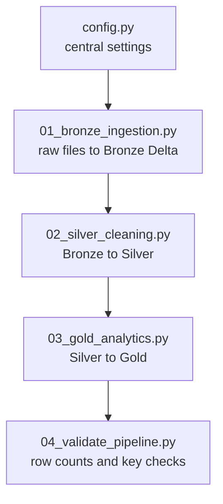

<p align="center">
  
</p>

<p align="center">
  
  
  
  
  
</p>

An end-to-end data engineering project that turns raw **GHCN-Daily** weather data (1950 to 2026) into analytics-ready tables for **Power BI**, using a **Bronze → Silver → Gold** medallion architecture on Databricks with Unity Catalog and Delta Lake.

---

## 📑 Table of Contents

1. [Project Overview](#-project-overview)
2. [Architecture](#-architecture)
3. [Databricks Configuration](#-databricks-configuration)
4. [Data Layers](#-data-layers)
5. [Gold Data Model](#-gold-data-model)
6. [How to Run](#-how-to-run)
7. [Data Quality Rules](#-data-quality-rules)
8. [Connecting Power BI](#-connecting-power-bi)
9. [Dashboard Preview](#-dashboard-preview)
10. [Validation Queries](#-validation-queries)
11. [Known Limitations](#-known-limitations)
12. [Troubleshooting](#-troubleshooting)
13. [Roadmap](#-roadmap)

---

## 🎯 Project Overview

| Item | Detail |
|---|---|
| **Goal** | Analyze long-term climate trends, extreme weather, and data quality across global weather stations |
| **Source** | GHCN-Daily (Global Historical Climatology Network, Daily), obtained from Kaggle |
| **Period** | 1950 to 2026 (2026 is a partial year) |
| **Platform** | Databricks, Unity Catalog, Delta Lake, PySpark |
| **Output** | 6 Gold tables for Power BI |
| **Key join column** | `station_id` |

**Questions this project answers**

- How have average temperatures changed since 1950, by country and globally?
- Where and how often do extreme heat, frost, and heavy rain days occur?
- What are the seasonal patterns by country?
- Which stations have reliable, long-running records?

---

## 🏗️ Architecture

<p align="center">
  
</p>

| Layer | Purpose | Write mode |
|---|---|---|
| **Raw** | Original files, untouched, in a Unity Catalog Volume | Copy |
| **Bronze** | One Delta table per source file, plus `_source_file` and `_ingested_at` | Overwrite |
| **Silver** | Standard types, trimmed text, range-checked values, deduplicated keys | Overwrite / append by year |
| **Gold** | Aggregations for reporting: station, country, global, monthly, quality | Overwrite |

---

## ⚙️ Databricks Configuration

| Object | Name |
|---|---|
| Catalog | `global_daily_weather_analysis_catelog` |
| Raw/source schema | `weather_1950_2026_schema` |
| Raw volume | `raw_files_volumn` |
| Bronze schema | `weather_1950_2026_bronze_schema` |
| Silver schema | `weather_1950_2026_silver_schema` |
| Gold schema | `weather_1950_2026_gold_schema` |

> **Note:** `catelog` and `volumn` are intentionally spelled as they appear in the Databricks objects. Renaming them requires updating every script.

**Example source path**

```
/Volumes/global_daily_weather_analysis_catelog/weather_1950_2026_schema/raw_files_volumn/weather/agg/ghcnd_inventory.parquet
```

---

## 🧱 Data Layers

### 🥉 Bronze (81 tables)

| Table(s) | Count | Description |
|---|---|---|
| `bronze_ghcnd_wide_1950` … `bronze_ghcnd_wide_2026` | 77 | Daily weather, one table per year |
| `bronze_ghcnd_wide_stations` | 1 | Station metadata (name, lat/lon, elevation, country, coverage) |
| `bronze_ghcnd_inventory` | 1 | Which elements each station reports and over which dates |
| `bronze_station_year_summary` | 1 | Pre-aggregated yearly statistics per station |
| `bronze_sample_wide_100k` | 1 | 100k-row sample for testing (not used in production) |

**Daily table columns:** `station_id`, `date`, `tmax_c`, `tmin_c`, `tavg_c`, `prcp_mm`, `snow_mm`, `snwd_mm`, `n_elements`, `qflag_count`, `_ingested_at`, `_source_file`

### 🥈 Silver

| Table | Grain | What was done |
|---|---|---|
| `silver_ghcnd_inventory` | station and element | Trimmed keys, derived `country_code`, `years_of_record`, `coverage_pct`; deduplicated |
| `silver_daily_weather` | station and date | Union of all yearly tables, typed, range-checked, derived columns, partitioned by `year` |
| `silver_stations` | station | Trimmed text, coordinate validation, deduplicated (built by the Gold script) |

**Derived columns in `silver_daily_weather`:** `year`, `month`, `day_of_year`, `tmean_c`, `diurnal_range_c`, `has_temp`, `has_prcp`, `_silver_processed_at`

### 🥇 Gold

| Table | Grain | Used for |
|---|---|---|
| `dim_station` | station | Map, filters, `climate_band`, `hemisphere` |
| `gold_station_year_climate` | station and year | Station drill-down, scatter map |
| `gold_country_year_climate` | country and year | Country trends and extreme-event counts |
| `gold_global_year_trend` | year | Headline warming trend |
| `gold_country_month_climate` | country, year, month | Seasonality heatmaps |
| `gold_station_data_quality` | station | Coverage and reliability page |

---

## 🗺️ Gold Data Model

<p align="center">
  
</p>

> `country_code` is not unique in `dim_station`, so in Power BI create a small `dim_country` table (distinct `country_code`, `country_name`) and relate the country tables to it.

### Climate metric definitions

| Metric | Definition |
|---|---|
| Hot day | Max temperature ≥ 30 °C |
| Extreme heat day | Max temperature ≥ 35 °C |
| Frost day | Min temperature < 0 °C |
| Deep freeze day | Min temperature ≤ -20 °C |
| Wet day | Precipitation ≥ 1 mm |
| Heavy rain day | Precipitation ≥ 25.4 mm (1 inch) |
| Snow day | Snowfall > 0 mm |
| Reliable station-year | At least 300 days with temperature data |
| Anomaly (`tmean_anomaly_c`) | Station-year mean temperature minus that station's own 1961–1990 average (needs at least 20 reliable baseline years) |

---

## ▶️ How to Run



| Order | Script | Responsibility | Status |
|---|---|---|---|
| 0 | `config.py` | Catalog, schema, and path settings | Drafted |
| 1 | `01_bronze_ingestion.py` | Raw files to Bronze Delta tables | Complete (81 tables) |
| 2 | `02_silver_cleaning.py` | Inventory and daily weather cleaning | Complete |
| 3 | `03_gold_analytics.py` | Stations dimension and 5 Gold tables | Ready to run |
| 4 | `04_validate_pipeline.py` | Row counts and key uniqueness | Planned |

**Steps**

1. **Bronze:** ingest every raw file into a managed Delta table with `_source_file` and `_ingested_at`.
2. **Silver:** build `silver_ghcnd_inventory` and `silver_daily_weather` (one year at a time, resumable with `FULL_REFRESH = False`).
3. **Gold:** build `silver_stations` and all six Gold tables.
4. **Validate** with the queries below.

> **Compute tip:** the daily data is large. Use a reasonably sized cluster or serverless compute. Scripts use `overwrite`, so reruns replace tables rather than duplicating rows.

---

## ✅ Data Quality Rules

| Area | Rule |
|---|---|
| Keys | `station_id` trimmed and uppercased; rows with NULL station or date are dropped |
| Dates | Parsed with `try_cast`; rows whose date does not match the table's year are dropped |
| Temperature | Values outside -90 to 60 °C become NULL |
| Precipitation and snow | Negative or implausible values (above 2,000 mm) become NULL; snow depth capped at 12,000 mm |
| Consistency | If `tmin_c` is greater than `tmax_c`, both are set to NULL |
| Duplicates | Deduplicated on `station_id + date` (latest `_ingested_at` wins) |
| Coordinates | Latitude outside ±90 or longitude outside ±180 becomes NULL |
| Aggregation | Country and global tables use reliable station-years only |

Bad values are nulled rather than dropping the whole row, so other valid measurements are kept.

---

## 🔌 Connecting Power BI

1. In Databricks, create or open a **SQL Warehouse** (serverless works well).
2. Copy the **Server hostname** and **HTTP path** from *Connection details*.
3. In Power BI Desktop: **Get Data → Azure Databricks**, paste the values, and sign in.
4. Select the six tables from `weather_1950_2026_gold_schema`.
5. Create relationships:
   - `dim_station[station_id]` → `gold_station_year_climate[station_id]` (one-to-many)
   - `dim_station[station_id]` → `gold_station_data_quality[station_id]` (one-to-one)
   - A `dim_country` table → the country year and month tables on `country_code`

---

## 📊 Dashboard Preview

> The image below is a **layout mockup** with placeholder numbers. Replace `images/dashboard_mockup.svg` with a real Power BI screenshot (for example `images/dashboard_overview.png`) and update the link.

<p align="center">
  
</p>

| Page | Visuals | Source table |
|---|---|---|
| **1. Global Overview** | KPI cards, anomaly line chart, station count | `gold_global_year_trend` |
| **2. Country Explorer** | Country slicer, temperature trend, extreme-day bars | `gold_country_year_climate` |
| **3. Station Map** | Map colored by `tmean_anomaly_c`, size by `n_days` | `gold_station_year_climate` + `dim_station` |
| **4. Seasonality** | Month × year heatmap of temperature and rainfall | `gold_country_month_climate` |
| **5. Extremes** | Hot, frost, and heavy-rain day trends, top 10 countries | `gold_country_year_climate` |
| **6. Data Quality** | Coverage histogram, reliable years, baseline stations | `gold_station_data_quality` |

**Design tips**

- Use a diverging color scale (blue → white → red) for anomalies, centered at 0.
- Show `n_stations` next to trend lines so readers can see sample-size changes.
- Exclude 2026 from annual charts, since it is a partial year.

---

## 🔍 Validation Queries

```python
CATALOG = "global_daily_weather_analysis_catelog"
G = f"`{CATALOG}`.`weather_1950_2026_gold_schema`"
S = f"`{CATALOG}`.`weather_1950_2026_silver_schema`"

# Tables per schema
spark.sql(f"""
SELECT table_schema, COUNT(*) AS table_count
FROM `{CATALOG}`.information_schema.tables
WHERE table_schema <> 'information_schema'
GROUP BY table_schema ORDER BY table_schema
""").show(truncate=False)

# Silver daily: duplicate keys (expect 0)
spark.sql(f"""
SELECT COUNT(*) AS dup_keys FROM (
  SELECT station_id, date FROM {S}.silver_daily_weather GROUP BY 1,2 HAVING COUNT(*) > 1)
""").show()

# Gold: unique keys (both expect 0)
spark.sql(f"SELECT COUNT(*) FROM (SELECT station_id FROM {G}.dim_station GROUP BY 1 HAVING COUNT(*)>1)").show()
spark.sql(f"SELECT COUNT(*) FROM (SELECT station_id, year FROM {G}.gold_station_year_climate GROUP BY 1,2 HAVING COUNT(*)>1)").show()

# Global anomaly trend (near 0 around 1961-1990, rising after)
spark.sql(f"SELECT year, n_stations, tmean_anomaly_c FROM {G}.gold_global_year_trend ORDER BY year").show(80)
```

---

## ⚠️ Known Limitations

- **Not area-weighted:** averages across stations favor densely sampled regions (such as the US). Treat the global line as indicative, not an official global temperature record.
- **Baseline dependency:** anomalies exist only for stations with at least 20 reliable years in 1961–1990. Check `n_stations_with_anomaly`.
- **Partial 2026:** most stations will not reach 300 temperature days, so 2026 largely drops out of reliable aggregates.
- **Country names:** if `country_name` is missing, the country code is used. GHCN country codes are FIPS-style, not ISO.
- **Thresholds are assumptions:** edit the heat, frost, and rain cutoffs in the Gold script if needed.
- **`silver_station_year_summary`** is not built yet; Gold recomputes yearly statistics from daily data.

---

## 🛠️ Troubleshooting

| Problem | Cause | Fix |
|---|---|---|
| `input_file_name()` is not supported | Unity Catalog restriction | Use `F.col("_metadata.file_path")` (applied) |
| Source path is a single file, not a folder | Discovery assumed directories | Script handles both files and directories |
| `UNRESOLVED_COLUMN ... _ingested_at` | Column-name cleaning stripped leading underscores | Keep the underscore prefix on lineage columns (fixed) |
| Silver row count is 0 or far below Bronze | Date parsing or range rules too strict | Check `printSchema()` and sample rows; adjust casts |
| Permission errors | Missing Unity Catalog grants | Needs `USE CATALOG`, `USE SCHEMA`, `CREATE TABLE`, `READ VOLUME` |
| Slow Silver run | 77 years of daily data | Use bigger or serverless compute; resume with `FULL_REFRESH = False` |

---

## 🚀 Roadmap

- [ ] Finalize `config.py` and make all scripts use it
- [ ] Add `04_validate_pipeline.py` (row counts, null checks, key uniqueness across layers)
- [ ] Build `silver_station_year_summary` and reconcile with Gold
- [ ] Switch daily Silver to incremental MERGE loads
- [ ] Add area-weighted (grid-cell) global averages
- [ ] Schedule the pipeline as a Databricks Workflow
- [ ] Publish the Power BI report and replace the mockup with real screenshots

---

## 📚 Data Source

GHCN-Daily, NOAA National Centers for Environmental Information, obtained via Kaggle and stored in a Unity Catalog Volume. Please review the original dataset's terms of use before redistributing.